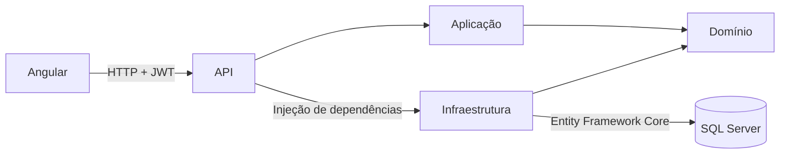

<div align="center">

# ✦ NoteKeeper

### Sua mente livre. Suas ideias por perto.

Um lugar para ideias, lembretes e planos.<br />
Organize por categorias, guarde o que importa e abra espaço para o novo.

<br />


<br />

[O projeto](#-o-projeto) · [Funcionalidades](#-funcionalidades) · [Como executar](#-como-executar) · [Arquitetura](#-arquitetura) · [API](#-api)

</div>

---

## 🌿 O projeto

O **NoteKeeper** é uma aplicação full stack para organizar notas pessoais. Cada conta tem seu próprio espaço para registrar ideias, associar categorias e alternar entre notas ativas e arquivadas.

A interface combina tons escuros, verdes e terrosos com cartões de notas e ícones. Por trás dela, uma API em ASP.NET Core concentra autenticação, regras de negócio e persistência em SQL Server.

> **Menos na cabeça. Mais no papel.** Uma ideia de cada vez.

## ✨ Funcionalidades

| Recurso | O que você pode fazer |
| --- | --- |
| 🔐 Conta pessoal | Criar uma conta, entrar e encerrar a sessão. |
| 📝 Notas | Cadastrar, visualizar detalhes, editar e excluir notas com título e descrição. |
| 🗂️ Categorias | Criar categorias e personalizá-las com ícones de pasta, livro, maleta, casa, estrela ou coração. |
| 🏷️ Organização | Associar várias categorias a uma mesma nota e filtrar o quadro por categorias. |
| 📦 Arquivamento | Alterar o status entre `Ativa` e `Arquivada` no painel de detalhes. |
| 👤 Dados por usuário | Consultar e gerenciar as notas e categorias da própria conta. |
| 📱 Interface responsiva | Navegar por layouts que se adaptam a diferentes tamanhos de tela. |
| 🌱 Página inicial | Explorar uma demonstração de notas com filtro por categoria antes de entrar. |

### Um passeio pelo aplicativo

1. **Crie sua conta** e entre no seu espaço.
2. **Cadastre categorias** para assuntos como estudos, trabalho ou vida pessoal.
3. **Registre uma nota**, adicione uma descrição e selecione suas categorias.
4. **Explore o quadro**, filtre por categoria e abra os detalhes de uma nota.
5. **Arquive o que já passou** e volte ao conteúdo quando precisar.

## 🧰 Tecnologias

| Camada | Tecnologias e responsabilidades |
| --- | --- |
| Interface | **Angular 22.2**, **TypeScript 6.0**, componentes standalone, Signals e carregamento de componentes sob demanda. |
| Estilos e ícones | **Tailwind CSS 4.1** e **Lucide Angular**. |
| Comunicação | **HttpClient**, **RxJS**, interceptor de autenticação e guards de rotas. |
| API | **ASP.NET Core / .NET 10**, controllers REST e documentação OpenAPI com Swagger UI. |
| Casos de uso | **MediatR**, comandos e consultas separados, resultados e erros com **FluentResults**. |
| Persistência | **Entity Framework Core 10**, migrations e **SQL Server**. |
| Autenticação | **ASP.NET Core Identity**, tokens **JWT** e revogação de tokens no logout. |
| Testes do backend | **xUnit** e **Moq**. |

As versões acima refletem os manifests do repositório.

## 🚀 Como executar

### Pré-requisitos

- **Git**.
- **SDK do .NET 10**.
- **Node.js** compatível com o Angular CLI deste projeto: `^22.22.3`, `^24.15.0` ou `>=26.0.0`, conforme o lockfile.
- **npm** — o projeto declara `npm@11.19.0` como gerenciador.
- **SQL Server** disponível e uma credencial com permissão para criar o banco e aplicar migrations.

Os comandos abaixo partem da raiz do repositório, salvo quando indicado. Os exemplos de configuração usam PowerShell.

### 1. Clone o repositório

```powershell
git clone https://github.com/k-silvax19/NoteKeeper.git
cd NoteKeeper
```

### 2. Configure o banco e a autenticação

A API precisa de uma connection string e de uma chave de assinatura JWT com **pelo menos 32 bytes**. O projeto já possui um `UserSecretsId`, permitindo configurar esses valores localmente com User Secrets.

Substitua o servidor, o usuário e a senha pelos dados da sua instância:

```powershell
dotnet user-secrets set "ConnectionStrings:SqlServer" "Server=localhost,1433;Database=NoteKeeperDb;User Id=SEU_USUARIO;Password=SUA_SENHA;TrustServerCertificate=True" --project server/src/Api
```

Gere uma chave aleatória e salve-a na configuração local:

```powershell
$jwtBytes = New-Object byte[] 64
$rng = [System.Security.Cryptography.RandomNumberGenerator]::Create()
$rng.GetBytes($jwtBytes)
$rng.Dispose()
$jwtKey = [Convert]::ToBase64String($jwtBytes)
dotnet user-secrets set "Jwt:SigningKey" $jwtKey --project server/src/Api
```

Os User Secrets ficam fora dos arquivos versionados e são carregados em desenvolvimento. A connection string configurada dessa forma substitui a configuração de desenvolvimento incluída no projeto.

### 3. Inicie a API

```powershell
dotnet restore server/NoteKeeper.slnx
dotnet run --project server/src/Api --launch-profile NoteKeeper.Api
```

O perfil `NoteKeeper.Api` usa o ambiente **Development**. Nesse ambiente, a aplicação aplica as migrations automaticamente ao iniciar, desde que o SQL Server esteja acessível e a credencial tenha as permissões necessárias.

| Serviço | Endereço local |
| --- | --- |
| API | `http://localhost:5146` |
| Swagger UI | `http://localhost:5146/swagger` |
| Documento OpenAPI | `http://localhost:5146/openapi/v1.json` |

### 4. Inicie o frontend

Em outro terminal, a partir da raiz:

```powershell
cd client
npm ci
npm start
```

Acesse **http://localhost:4200** e crie sua conta.

> No PowerShell, caso a política de execução bloqueie o arquivo `npm.ps1`, use `npm.cmd ci` e `npm.cmd start`.

### Configurações de ambiente

| Configuração | Onde ajustar | Valor ou comportamento |
| --- | --- | --- |
| Conexão com o banco | User Secrets: `ConnectionStrings:SqlServer` | Sua instância do SQL Server. |
| Chave JWT | User Secrets: `Jwt:SigningKey` | Chave com pelo menos 32 bytes. |
| Emissor e público JWT | `server/src/Api/appsettings.json` | `notekeeper-api` e `notekeeper-client`. |
| Validade do token | `Jwt:ExpiresInMinutes` | 60 minutos na configuração versionada. |
| Origem permitida pelo CORS | `server/src/Api/appsettings.Development.json` | `http://localhost:4200`. |
| URL da API no desenvolvimento | `client/src/app/environments/environment.development.ts` | `http://localhost:5146`. |
| URL da API no build de produção | `client/src/app/environments/environment.ts` | Também aponta para localhost; ajuste para o destino do deploy. |

Em outros ambientes, os mesmos valores podem ser fornecidos por variáveis como `ConnectionStrings__SqlServer`, `Jwt__SigningKey` e `Cors__AllowedOrigins__0`.

<details>
<summary><strong>Aplicar migrations manualmente</strong></summary>

Se precisar executar as migrations fora da inicialização da API, use os comandos abaixo a partir da raiz:

```powershell
cd server
dotnet tool restore --tool-manifest dotnet-tools.json
dotnet ef database update --project src/Infraestrutura --startup-project src/Api
```

A factory de design time lê User Secrets e variáveis de ambiente. Configure `ConnectionStrings:SqlServer` como descrito acima para que ela use a mesma conexão da API.

</details>

## 🏗️ Arquitetura

O backend organiza o código em quatro projetos, separando a entrada HTTP, os casos de uso, as entidades e o acesso a dados.



| Projeto | Responsabilidade |
| --- | --- |
| **Api** | Controllers, configuração de autenticação, CORS, OpenAPI e composição dos serviços. |
| **Aplicacao** | Handlers de comandos e consultas, DTOs e tratamento de resultados. |
| **Dominio** | Entidades, validações e contratos dos repositórios e serviços de autenticação. |
| **Infraestrutura** | DbContext, migrations, repositórios, Identity e persistência dos tokens revogados. |

### Estrutura do repositório

```text
NoteKeeper/
├── client/
│   ├── public/                     # Arquivos públicos
│   └── src/app/
│       ├── auth/                   # Cadastro, login, sessão, guard e interceptor
│       ├── categorias/             # Telas e serviços de categorias
│       ├── environments/           # URL da API por ambiente
│       ├── home/                   # Apresentação e demonstração
│       ├── notas/                  # Quadro, formulários e detalhes de notas
│       └── shared/                 # Componentes compartilhados
├── server/
│   ├── src/
│   │   ├── Api/
│   │   ├── Aplicacao/
│   │   ├── Dominio/
│   │   └── Infraestrutura/
│   ├── tests/NoteKeeper.Tests/     # Testes de entidades e handlers
│   ├── dotnet-tools.json           # Ferramenta local do Entity Framework
│   └── NoteKeeper.slnx
├── GUIA-TAILWIND.md
└── README.md
```

## 🔌 API

As rotas abaixo são relativas à URL base da API. Cadastro e login são públicos; os demais endpoints da tabela exigem autenticação.

```http
Authorization: Bearer SEU_TOKEN_JWT
```

| Método | Rota | Operação |
| --- | --- | --- |
| `POST` | `/auth/cadastro` | Cadastrar usuário. |
| `POST` | `/auth/login` | Autenticar usuário. |
| `GET` | `/auth/me` | Obter o usuário autenticado. |
| `POST` | `/auth/logout` | Revogar o token da sessão atual. |
| `GET` | `/categorias` | Listar categorias da conta. |
| `GET` | `/categorias/{id}` | Consultar uma categoria. |
| `POST` | `/categorias` | Criar uma categoria. |
| `PUT` | `/categorias/{id}` | Atualizar uma categoria. |
| `DELETE` | `/categorias/{id}` | Excluir uma categoria. |
| `GET` | `/notas` | Listar notas, com filtro opcional por `categoriaIds`. |
| `GET` | `/notas/{id}` | Consultar uma nota. |
| `POST` | `/notas` | Criar uma nota ativa. |
| `PUT` | `/notas/{id}` | Atualizar conteúdo, status e categorias. |
| `DELETE` | `/notas/{id}` | Excluir uma nota. |

### Exemplo: criar uma nota

Envie para `POST /notas`, com o token de autenticação:

```json
{
  "titulo": "Ideias para o próximo projeto",
  "descricao": "Separar referências e desenhar as primeiras telas.",
  "categoriaIds": []
}
```

Para associar categorias, preencha `categoriaIds` com os IDs das categorias da sua conta. Para filtrar por mais de uma categoria, repita o parâmetro na URL: `/notas?categoriaIds=ID_1&categoriaIds=ID_2`.

Explore os contratos completos no **Swagger UI** com a API em execução.

## 📐 Regras de negócio

- Títulos de notas e categorias devem ter **entre 2 e 100 caracteres**.
- A descrição da nota é opcional e aceita **até 300 caracteres**.
- Novas notas começam com o status **`Ativa`**.
- Uma nota pode estar associada a várias categorias da própria conta.
- O cadastro de notas rejeita títulos duplicados para o mesmo usuário, usando o título normalizado.
- As senhas exigem **pelo menos 8 caracteres**, incluindo um número e um caractere especial.
- O Identity está configurado para bloqueio de **5 minutos após 5 tentativas de acesso inválidas**.
- O logout revoga o identificador do token, que é consultado na validação das próximas requisições.

## 🧪 Testes e build

### Backend

Execute a partir da raiz:

```powershell
dotnet test server/NoteKeeper.slnx
dotnet build server/NoteKeeper.slnx --configuration Release
```

Os testes existentes abrangem entidades e handlers de autenticação, categorias e notas, com **xUnit** e **Moq**. O projeto de testes referencia as camadas de aplicação e domínio.

### Frontend

Dentro de `client`:

```powershell
npm run build
```

O build padrão usa a configuração de produção. Há também o script `npm test`, configurado com o executor de testes do Angular e Vitest; atualmente não há arquivos de teste do frontend versionados.

## 🛠️ Solução de problemas

| Situação | O que conferir |
| --- | --- |
| API não inicia por erro de JWT | Configure `Jwt:SigningKey` nos User Secrets com pelo menos 32 bytes. |
| Falha ao conectar ou aplicar migrations | Confira se o SQL Server está ativo, a porta, as credenciais e as permissões da conta. |
| Frontend não consegue acessar a API | Verifique se a API está na porta `5146` e se `urlApi` corresponde ao endereço em uso. |
| Erro de CORS | A origem do frontend deve estar em `Cors:AllowedOrigins` no ambiente da API. |
| Requisição retorna `401` | Entre novamente e confirme o envio do token; ele pode ter expirado ou sido revogado. |
| Instalação do frontend falha por versão do Node.js | Confira os requisitos de Node.js indicados nos pré-requisitos. |

## 📚 Material de apoio

- [Guia de Tailwind CSS](GUIA-TAILWIND.md)
- [Exemplos de requisições HTTP](server/src/Api/NoteKeeper.Api.http)
- [Testes do backend](server/tests/NoteKeeper.Tests)

---

<div align="center">

**NoteKeeper — um lugar para suas ideias. Um respiro para sua mente.**

[Voltar ao topo](#-notekeeper)

</div>
